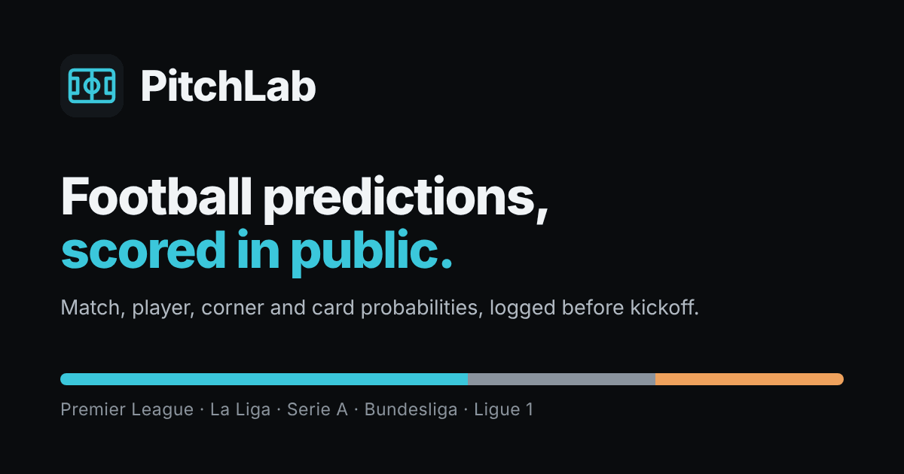
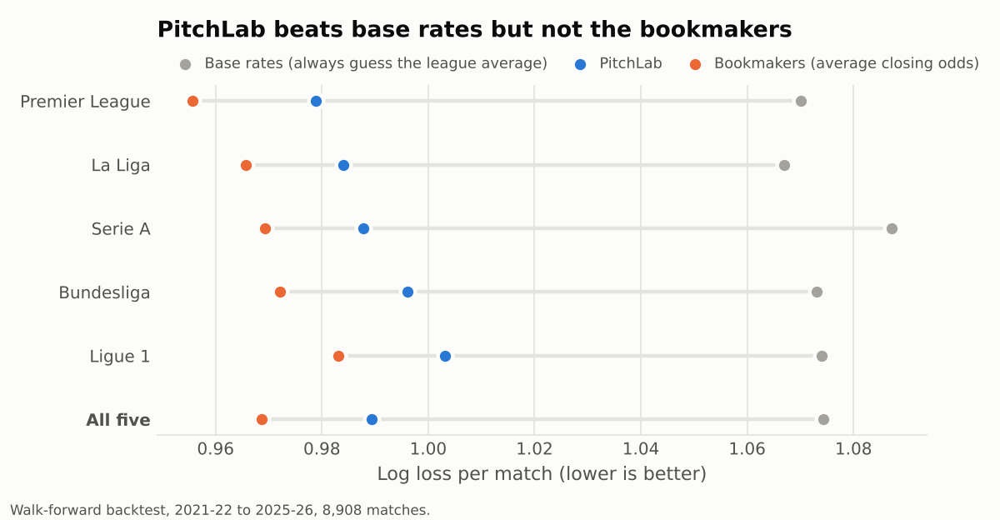
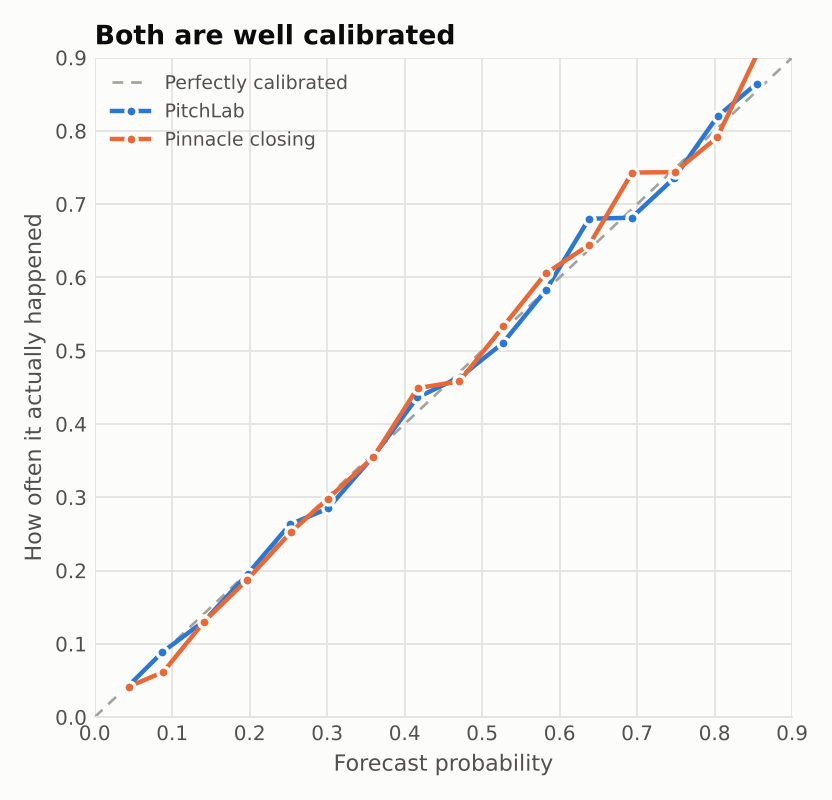
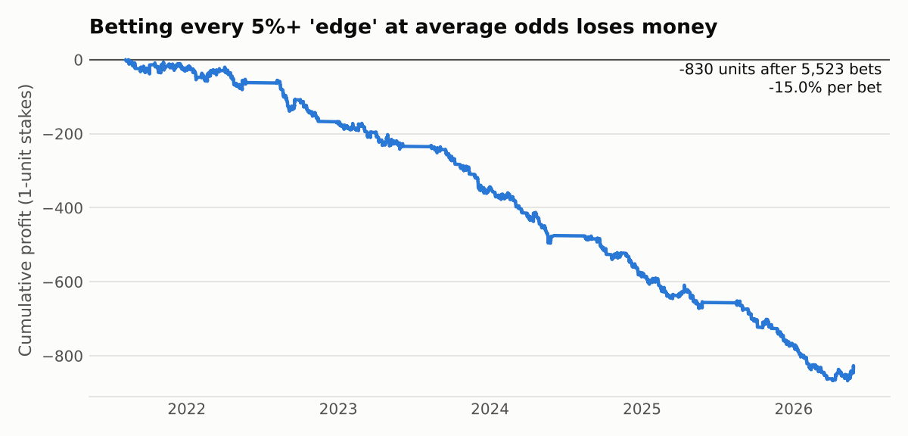

# PitchLab



**Live: [pboy221.github.io/Pitchlab](https://pboy221.github.io/Pitchlab/)**

Match, player, corner and card probabilities for the Premier League, La Liga,
Serie A, Bundesliga and Ligue 1. The site rebuilds itself every six hours from free
data, and every forecast is written to a public ledger before kickoff and
scored after the final whistle, so the accuracy claims can be checked rather
than taken on trust.

## What it shows

- **Fixtures** for the next two weeks: home/draw/away, expected goals, likeliest
  scores, over 2.5, both teams to score, corners and cards (with the referee's
  own strictness once appointed).
- **Players** (Premier League): chance to score, assist and be booked, plus
  predicted lineups.
- **Recent results** next to what the model said beforehand.
- **Accuracy**: walk-forward backtest (log loss, Brier score, calibration), the
  bookmakers' score on the same matches, and the live ledger.
- **Styles**: eight playing-style dimensions per team, and whether a side
  genuinely changes its game by fixture (tested with a false-discovery correction).

Each match has its own link (`#match-…`) with a Share button, and the site can be
installed to a phone's home screen and opened offline.

## How it updates itself

`.github/workflows/daily.yml` runs on GitHub Actions every six hours
(at :17 past 00, 06, 12 and 18 UTC). GitHub's free scheduler can run late or skip
a run at busy times, so four slots a day means a missed one never matters, and an
independent watchdog (a Claude scheduled task every two days) checks the latest
successful run and triggers a rebuild if the site is ever more than 30 hours old.
Each run also commits a heartbeat (`data/last_run.txt`), which stops GitHub from
switching the schedule off after 60 quiet days in the off-season. Each run:

1. runs the test suite: a failing test stops the run before anything deploys;
2. downloads results and stats from **football-data.co.uk**, upcoming fixtures
   from football-data.co.uk and **openfootball**, and Premier League player data
   from the **Fantasy Premier League** feed;
3. refits the models and re-runs the backtest;
4. logs every upcoming forecast to `data/ledger.json`, settles finished matches,
   and commits the ledger back to the repository;
5. publishes the site to **GitHub Pages**.

If football-data.co.uk is down during the season the run fails on purpose,
GitHub emails the owner, and the previous site stays up. The header shows how
long ago the site was updated, and turns orange after 36 hours.

## Model

| Market | Method |
|---|---|
| Result, scores, goals | Poisson regression on attack, defence and home advantage; time-weighted (decay 0.0015/day), ridge-shrunk toward average (1.0); Dixon-Coles correction for low-score draws |
| Corners, cards | Same team model on their own counts, negative-binomial spread fitted per league; per-referee card multiplier with shrinkage |
| Players | FPL xG, xA and booking rates per 90, shrunk toward position averages, scaled by minutes, availability and this match's team expectation |
| Styles | z-scores on eight dimensions over each side's last 38 matches; situational shifts by Welch t-test with Benjamini-Hochberg correction |

Tuning was done on 2024–26 walk-forward backtests across all five leagues
(predict each week only from matches before it). Results: 4–9% better log loss
than each league's base rates, calibration error around 0.02. How that compares
with the bookmakers is below.

## Benchmark: PitchLab vs the bookmakers

**Question:** does a free, results-only model know anything the betting market doesn't?
**Answer: no.** PitchLab beats naive base rates comfortably but loses to the bookmakers
in every league and every season, and trying to bet on its disagreements loses money.



Every match from 2021-22 to 2025-26 in all five leagues (8,908 matches) was predicted
walk-forward: the model was refitted each week on the previous three years and only
saw matches played before that week. Its probabilities were then scored against the
bookmakers' prices for the same matches, with the bookmaker margin removed.

| League | Matches | Base rates | PitchLab | Bookmakers (avg closing) | Pinnacle closing | PitchLab minus Pinnacle (95% CI) |
|---|---:|---:|---:|---:|---:|---|
| Premier League | 1,900 | 1.070 | 0.979 | 0.956 | 0.947 | +0.023 (+0.014 to +0.031) |
| La Liga | 1,900 | 1.067 | 0.984 | 0.966 | 0.964 | +0.019 (+0.011 to +0.027) |
| Serie A | 1,900 | 1.087 | 0.988 | 0.969 | 0.969 | +0.020 (+0.013 to +0.028) |
| Bundesliga | 1,530 | 1.073 | 0.996 | 0.972 | 0.971 | +0.026 (+0.017 to +0.036) |
| Ligue 1 | 1,678 | 1.074 | 1.003 | 0.983 | 0.982 | +0.020 (+0.011 to +0.029) |
| **All five** | 8,908 | 1.074 | 0.989 | 0.969 | 0.966 | +0.021 (+0.018 to +0.025) |

| Betting rule (flat 1-unit stakes, average pre-match odds) | Bets | Hit rate | Avg odds | ROI per bet (95% CI) |
|---|---:|---:|---:|---|
| Back the best outcome when model edge > 2% | 6,696 | 28.1% | 4.21 | -12.9% (-16.8% to -9.0%) |
| Back the best outcome when model edge > 5% | 5,523 | 26.1% | 4.42 | -15.0% (-19.6% to -10.6%) |
| Back the best outcome when model edge > 10% | 4,004 | 23.8% | 4.82 | -16.5% (-21.9% to -11.1%) |

Log loss is the main score (lower is better; 1.099 is a coin toss across three
outcomes). The confidence intervals come from resampling matches (2,000 bootstrap
draws), so the gap to the market is real and not noise.

### What I found

1. **The model has real skill.** It is 7.9% better than always predicting the
   league's average home/draw/away split, and it is well calibrated: when it says
   30%, it happens about 30% of the time.
2. **The market is better, by about 0.02 log loss per match**, in every league and
   every season. The model calls 52.4% of results right; Pinnacle's closing
   favourite wins 54.3% of the time.
3. **The model is too cautious about favourites.** On average it gives the market
   favourite 51.1%, the market says 52.9%, and favourites actually won 54.3%. Ridge
   shrinkage and time decay pull every team toward average, which flattens the
   probabilities.
4. **Its "edges" are mostly its own mistakes.** Backing every outcome the model
   rates at least 5% above the market price loses 15% per bet, which is worse than the
   ~5% bookmaker margin. The bigger the claimed edge, the bigger the loss (-12.9% at
   2%, -16.5% at 10%), and 55% of these bets were on away sides at long odds. When
   this model disagrees with the market, the market is usually right.





### Limitations

- The market average pre-match odds (the betting prices) are collected a day or two
  before kickoff, so they are a fair but approximate stand-in for what a bettor could get.
- Pinnacle closing odds are missing for about half of 2025-26 in the source data;
  the market-average closing benchmark covers every match and tells the same story.
- Results only: no lineups, injuries, xG or transfer news, which is exactly the
  information the market prices in and this model cannot see.

### Next experiments

- Reduce the ridge penalty and time decay, and re-run this benchmark to test whether
  less shrinkage closes the gap on favourites (finding 3).
- Add shot-based features (shots on target are already in the data) as a cheap proxy
  for expected goals.
- Blend the model with the market price and test whether the blend beats either one alone.

### Reproduce it

```bash
pip install -r requirements-analysis.txt
python -m analysis.benchmark                              # downloads from football-data.co.uk
python -m analysis.benchmark --data-dir path/to/csvs      # or a local copy, no network
```

It takes about 15 seconds and writes `reports/benchmark/` (`results.json`, `results.md` and
the three charts). The numbers above were produced from football-data.co.uk's season
files as of November 2026.

## Data and attribution

Match data © [football-data.co.uk](https://www.football-data.co.uk);
fixtures from [openfootball](https://github.com/openfootball/football.json)
(public domain); player data from the
[Fantasy Premier League](https://fantasy.premierleague.com) public feed. PitchLab
is a free, non-commercial project with no ads, accounts, tracking or cookies.
Check each source's terms before adding anything commercial.

## Responsible use

PitchLab publishes statistical estimates, not tips or betting advice, and does
not take, place or facilitate bets. Intended for adults 18+. If gambling is
causing harm, GambleAware NSW offers free, confidential support on
1800 858 858.

## Run it yourself

```bash
pip install -r requirements.txt -r requirements-dev.txt
python -m pytest                                   # offline tests, ~10 s
python -m pipeline.build --out public              # live data
python -m http.server -d public                    # then open localhost:8000

# replay any past date from the GitHub mirror of football-data
python -m pipeline.build --mode mirror --as-of 2026-03-14 \
    --out /tmp/replay --ledger /tmp/replay-ledger.json
```

**Custom domain:** change `SITE_URL` in `pipeline/config.py`, then add the
domain under the repository's Settings → Pages.

**Artwork:** icons and the share image are generated by `tools/make_assets.py`.

## Layout

| Path | What it does |
|---|---|
| `pipeline/sources.py` | downloads and normalises every data source |
| `pipeline/names.py` | maps openfootball and FPL team names onto football-data names |
| `pipeline/ratings.py` | team strength model |
| `pipeline/markets.py` | per-fixture markets |
| `pipeline/backtest.py` | walk-forward backtest, calibration and bookmaker comparison |
| `pipeline/odds.py` | bookmaker odds to probabilities, betting simulation |
| `analysis/benchmark.py` | five-season benchmark against the bookmakers (writes `reports/benchmark/`) |
| `pipeline/styles.py` | style profiles and situational shifts |
| `pipeline/players.py` | Premier League player markets |
| `pipeline/ledger.py` | pre-kickoff forecast ledger |
| `pipeline/site_files.py` | manifest, service worker, 404, robots, sitemap |
| `pipeline/build.py` | runs everything and writes `public/` |
| `site/template.html` | the page (data injected at build time) |
| `site/static/` | self-hosted Inter font, icons, share image |
| `tests/` | offline test suite |
| `data/ledger.json` | the forecast record, written by the bot |

## Licence

Code: MIT (see `LICENSE`). Inter font: SIL Open Font License
(`site/static/fonts/OFL.txt`).
