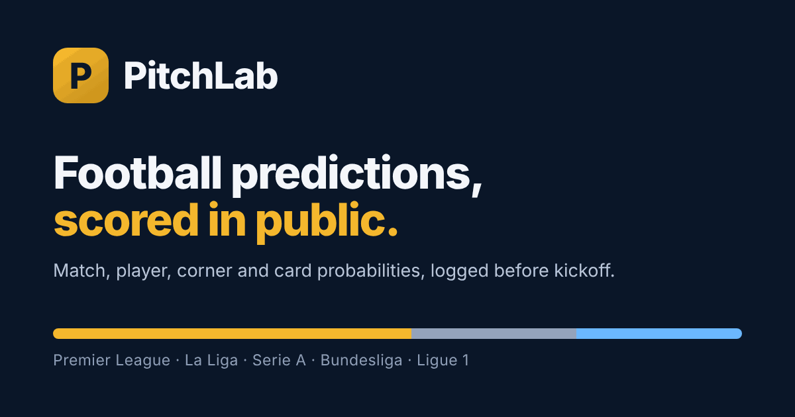

# PitchLab



**Live: [pboy221.github.io/Pitchlab](https://pboy221.github.io/Pitchlab/)**

Match, player, corner and card probabilities for the Premier League, La Liga,
Serie A, Bundesliga and Ligue 1. The site rebuilds itself twice a day from free
data, and every forecast is written to a public ledger before kickoff and
scored after the final whistle, so the accuracy claims can be checked rather
than taken on trust.

## What it shows

- **Fixtures** for the next two weeks: home/draw/away, expected goals, likeliest
  scores, over 2.5, both teams to score, corners and cards (with the referee's
  own strictness once appointed).
- **Players** (Premier League): chance to score, assist and be booked, plus
  predicted lineups.
- **Recent results** next to what the model said beforehand.
- **Accuracy**: walk-forward backtest (log loss, Brier score, calibration) and
  the live ledger.
- **Styles**: eight playing-style dimensions per team, and whether a side
  genuinely changes its game by fixture (tested with a false-discovery correction).

Each match has its own link (`#match-…`) with a Share button, and the site can be
installed to a phone's home screen and opened offline.

## How it updates itself

`.github/workflows/daily.yml` runs on GitHub Actions twice a day (06:17 and
18:17 UTC; GitHub's free scheduler can run late at busy times). Each run:

1. runs the test suite: a failing test stops the run before anything deploys;
2. downloads results and stats from **football-data.co.uk**, upcoming fixtures
   from football-data.co.uk and **openfootball**, and Premier League player data
   from the **Fantasy Premier League** feed;
3. refits the models and re-runs the backtest;
4. logs every upcoming forecast to `data/ledger.json`, settles finished matches,
   and commits the ledger back to the repository;
5. publishes the site to **GitHub Pages**.

If football-data.co.uk is down during the season the run fails on purpose,
GitHub emails the owner, and the previous site stays up. The header shows how
long ago the site was updated, and turns orange after 36 hours.

## Model

| Market | Method |
|---|---|
| Result, scores, goals | Poisson regression on attack, defence and home advantage; time-weighted (decay 0.0015/day), ridge-shrunk toward average (1.0); Dixon-Coles correction for low-score draws |
| Corners, cards | Same team model on their own counts, negative-binomial spread fitted per league; per-referee card multiplier with shrinkage |
| Players | FPL xG, xA and booking rates per 90, shrunk toward position averages, scaled by minutes, availability and this match's team expectation |
| Styles | z-scores on eight dimensions over each side's last 38 matches; situational shifts by Welch t-test with Benjamini-Hochberg correction |

Tuning was done on 2024–26 walk-forward backtests across all five leagues
(predict each week only from matches before it). Results: 4–9% better log loss
than each league's base rates, calibration error around 0.02.

## Data and attribution

Match data © [football-data.co.uk](https://www.football-data.co.uk);
fixtures from [openfootball](https://github.com/openfootball/football.json)
(public domain); player data from the
[Fantasy Premier League](https://fantasy.premierleague.com) public feed. PitchLab
is a free, non-commercial project with no ads, accounts, tracking or cookies.
Check each source's terms before adding anything commercial.

## Responsible use

PitchLab publishes statistical estimates, not tips or betting advice, and does
not take, place or facilitate bets. Intended for adults 18+. If gambling is
causing harm, GambleAware NSW offers free, confidential support on
1800 858 858.

## Run it yourself

```bash
pip install -r requirements.txt -r requirements-dev.txt
python -m pytest                                   # offline tests, ~10 s
python -m pipeline.build --out public              # live data
python -m http.server -d public                    # then open localhost:8000

# replay any past date from the GitHub mirror of football-data
python -m pipeline.build --mode mirror --as-of 2026-03-14 \
    --out /tmp/replay --ledger /tmp/replay-ledger.json
```

**Custom domain:** change `SITE_URL` in `pipeline/config.py`, then add the
domain under the repository's Settings → Pages.

**Artwork:** icons and the share image are generated by `tools/make_assets.py`.

## Layout

| Path | What it does |
|---|---|
| `pipeline/sources.py` | downloads and normalises every data source |
| `pipeline/names.py` | maps openfootball and FPL team names onto football-data names |
| `pipeline/ratings.py` | team strength model |
| `pipeline/markets.py` | per-fixture markets |
| `pipeline/backtest.py` | walk-forward backtest and calibration |
| `pipeline/styles.py` | style profiles and situational shifts |
| `pipeline/players.py` | Premier League player markets |
| `pipeline/ledger.py` | pre-kickoff forecast ledger |
| `pipeline/site_files.py` | manifest, service worker, 404, robots, sitemap |
| `pipeline/build.py` | runs everything and writes `public/` |
| `site/template.html` | the page (data injected at build time) |
| `site/static/` | self-hosted Inter font, icons, share image |
| `tests/` | offline test suite |
| `data/ledger.json` | the forecast record, written by the bot |

## Licence

Code: MIT (see `LICENSE`). Inter font: SIL Open Font License
(`site/static/fonts/OFL.txt`).
